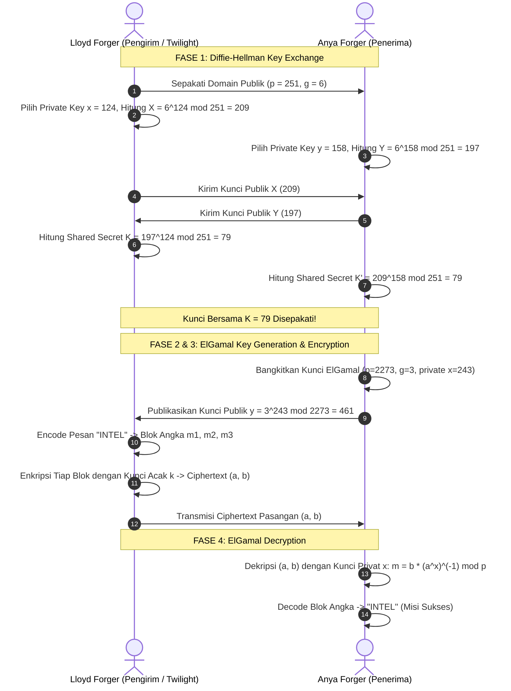

# LAPORAN PROGRAM & DOKUMENTASI SISTEM KRIPTOGRAFI
## Diffie-Hellman Key Exchange & ElGamal Asymmetric Cryptosystem
> **Studi Kasus:** Operasi Strix (*Spy x Family*) — Secure Intelligence Communication System  
> **Repository:** [github.com/KhosySyehab/diffie-hellman-elgamal](https://github.com/KhosySyehab/diffie-hellman-elgamal)

---

## IDENTITAS KELOMPOK
Dokumentasi ini sekaligus berfungsi sebagai **Laporan Resmi Program Kriptografi** sesuai ketentuan tugas.

| Komponen | Keterangan |
| :--- | :--- |
| **Kelompok** | **Kelompok [X]** *(Isi nomor kelompok di sini)* |
| **Anggota 1 (Orang 1)** | `Jofanka Al-Kautsar Pangsetu Abady` - `5027241107` |
| **Anggota 2 (Orang 2)** | `Muhammad Khosyi Syehab` - `5027241089` |
| **Anggota 3 (Orang 3)** | `Muhammad Khairul Yahya` - `5027241092` |
| **Mata Kuliah** | Kriptografi |
| **Dosen Pengampu** | `Annisaa Sri Indrawanti, S.Kom., M.Kom.` |
| **Program Studi / Institusi** | `Institut Teknologi Sepuluh Nopember` |
| **Tanggal Rilis** | Oktober 2026 |

---

## DAFTAR ISI
1. [Ringkasan Eksekutif (Executive Summary)](#1-ringkasan-eksekutif-executive-summary)
2. [Skenario & Studi Kasus: Operasi Strix](#2-skenario--studi-kasus-operasi-strix)
3. [Landasan Teori & Formulasi Matematika](#3-landasan-teori--formulasi-matematika)
4. [Arsitektur Sistem & Spesifikasi Modul](#4-arsitektur-sistem--spesifikasi-modul)
5. [Pembagian Jobdesk (Sequential Workflow)](#5-pembagian-jobdesk-sequential-workflow)
6. [Panduan Instalasi & Eksekusi](#6-panduan-instalasi--eksekusi)
7. [Hasil Pengujian & Verifikasi Matematis](#7-hasil-pengujian--verifikasi-matematis)
8. [Tangkapan Layar Antarmuka (GUI Preview)](#8-tangkapan-layar-antarmuka-gui-preview)
9. [Analisis Keamanan & Kompleksitas Algoritma](#9-analisis-keamanan--kompleksitas-algoritma)
10. [Instruksi Pengemasan (Submission ZIP)](#10-instruksi-pengemasan-submission-zip)

---

## 1. RINGKASAN EKSEKUTIF (EXECUTIVE SUMMARY)

Sistem ini merupakan implementasi perangkat lunak kriptografi kunci publik murni (*Zero External Library*) yang mengintegrasikan dua pilar utama kriptografi asimetris dalam satu studi kasus yang kohesif:
1. **Diffie-Hellman Key Exchange (DHKE)**: Protokol pertukaran kunci untuk menyepakati kunci sesi simetris melalui saluran komunikasi terbuka (*insecure channel*).
2. **ElGamal Public-Key Encryption**: Kriptosistem asimetris berbasis pengacakan modular (*probabilistic public-key encryption*) untuk menjamin kerahasiaan (*confidentiality*) dan keutuhan pesan intelijen.

### Karakteristik Kunci Sistem:
* **Zero External Dependencies**: Seluruh algoritma aritmetika modular (eksponensial modular biner cepat, uji bilangan prima, pencarian akar primitif, invers modulo Fermat & Extended Euclidean) diimplementasikan secara mandiri dari awal menggunakan pustaka standar Python.
* **Dual Interface**: Dilengkapi Graphical User Interface (GUI) modern dengan tema *dark neumorphic* berbasis Tkinter yang responsif, menyajikan log komputasi matematis langkah demi langkah (*step-by-step transparency*).
* **Robust Encoding**: Mendukung segmentasi pesan teks menjadi blok numerik multi-digit berdasar modulus bilangan prima $p$ ($A=00, \dots, Z=25$) secara otomatis.

---

## 2. SKENARIO & STUDI KASUS: OPERASI STRIX

Proyek ini mengangkat skenario intelijen taktis yang diadaptasi dari misi spionase:

> **Latar Belakang:**  
> **Agen Lloyd Forger** (*Codename: Twilight*) bertugas di lapangan dan mengumpulkan laporan intelijen berlabel `INTEL`. Laporan ini harus dikirimkan secara aman kepada **Anya Forger** di markas pusat. Musuh memantau seluruh saluran komunikasi radio secara agresif.



---

## 3. LANDASAN TEORI & FORMULASI MATEMATIKA

### 3.1. Algoritma Aritmetika Modular Inti
1. **Fast Exponentiation (Square-and-Multiply):**  
   Menghitung $b^e \pmod m$ dalam kompleksitas waktu $\mathcal{O}(\log e)$, mencegah *integer overflow*:
   $$\text{mod\_exp}(b, e, m) \implies b^e \equiv \prod_{i=0}^{k-1} (b^{2^i})^{e_i} \pmod m$$
2. **Uji Akar Primitif (Primitive Root Modulo $p$):**  
   Bilangan $g$ adalah akar primitif dari bilangan prima $p$ jika derajat (*order*) dari $g$ modulo $p$ sama dengan $p-1$:
   $$\{g^1 \bmod p, g^2 \bmod p, \dots, g^{p-1} \bmod p\} = \{1, 2, \dots, p-1\}$$
3. **Invers Modulo (Fermat's Little Theorem):**  
   Untuk bilangan prima $p$ dan $\gcd(a, p) = 1$:
   $$a^{p-1} \equiv 1 \pmod p \implies a^{-1} \equiv a^{p-2} \pmod p$$
   Atau untuk proses dekripsi ElGamal:
   $$(a^x)^{-1} \equiv a^{p-1-x} \pmod p$$

---

### 3.2. Protokol Pertukaran Kunci Diffie-Hellman (DHKE)
* **Parameter Bersama:** Bilangan prima besar $n$ dan generator akar primitif $g \in \mathbb{Z}_n^*$.
* **Pembangkitan Kunci Lokal:**
  * Lloyd memilih $x \in [1, n-2]$ (kunci privat) $\to$ menghitung $X = g^x \pmod n$ (kunci publik).
  * Anya memilih $y \in [1, n-2]$ (kunci privat) $\to$ menghitung $Y = g^y \pmod n$ (kunci publik).
* **Komputasi Kunci Bersama:**
  * Lloyd menghitung: $K = Y^x \pmod n = (g^y)^x \pmod n = g^{xy} \pmod n$.
  * Anya menghitung: $K' = X^y \pmod n = (g^x)^y \pmod n = g^{xy} \pmod n$.
  * Kesimpulan: $K = K'$, kunci rahasia berhasil disepakati.

---

### 3.3. Kriptosistem Asimetris ElGamal
* **1. Pembangkitan Kunci (Key Generation):**
  * Pilih bilangan prima $p$ dan akar primitif $g$.
  * Pilih kunci privat acak $x \in [1, p-2]$.
  * Hitung kunci publik $y = g^x \pmod p$. Pasangan kunci: Kunci Publik $(p, g, y)$, Kunci Privat $x$.
* **2. Enkripsi (Encryption):**
  * Representasikan plainteks sebagai integer $m$ sedemikian sehingga $0 \le m < p$.
  * Pilih nilai acak ephemeral $k \in [1, p-2]$ dengan $\gcd(k, p-1) = 1$.
  * Hitung:
    $$a = g^k \pmod p$$
    $$b = (y^k \cdot m) \pmod p$$
  * Ciphertext yang dikirim: Pasangan tuple $(a, b)$.
* **3. Dekripsi (Decryption):**
  * Rekonstruksi pesan asli menggunakan kunci privat $x$:
    $$m = \frac{b}{a^x} \equiv b \cdot (a^x)^{-1} \equiv b \cdot a^{p-1-x} \pmod p$$

---

## 4. ARSITEKTUR SISTEM & SPESIFIKASI MODUL

Repositori dibangun dengan prinsip arsitektur modular yang independen dan terisolasi:

```
diffie-hellman-elgamal/
├── .gitignore              # Konfigurasi eksklusi cache Python (__pycache__)
├── README.md               # Laporan Program Komprehensif & Dokumentasi Sistem
├── math_utils.py           # [Orang 1] Library utilitas matematika modular murni
├── diffie_hellman.py       # [Orang 1] Engine protokol Diffie-Hellman
├── elgamal.py              # [Orang 2] Engine enkripsi, dekripsi, & encoding ElGamal
├── main.py                 # [Orang 2] Antarmuka GUI Tkinter (Operasi Strix)
├── planning_tugas_elgamal.md # Dokumen perencanaan & spesifikasi teknis awal
└── soal.txt                # Ketentuan tugas dari instruktur / dosen
```

### Rincian Fungsi Tiap Modul

#### Modul `math_utils.py` (Fondasi Komputasi)
* `is_prime(n) -> bool`: Menguji keprimaan bilangan bulat positif melalui deterministik *trial division* efisien.
* `mod_exp(base, exp, mod) -> int`: Menghitung eksponensiasi modular cepat (*square-and-multiply*).
* `mod_inverse(a, p) -> int`: Menghitung invers perkalian modular $a^{-1} \pmod p$.
* `is_primitive_root(g, p) -> bool`: Memverifikasi apakah $g$ merupakan generator dari grup $\mathbb{Z}_p^*$.

#### Modul `diffie_hellman.py` (Protokol Pertukaran Kunci)
* `diffie_hellman(n, g, x, y) -> dict`: Menjalankan siklus pertukaran kunci lengkap antara Lloyd dan Anya, memvalidasi keprimaan $n$, memeriksa status akar primitif $g$, menghitung kunci publik $X$ dan $Y$, serta memverifikasi kesamaan kunci sesi rahasia $K = K'$.

#### Modul `elgamal.py` (Kriptosistem Asimetris)
* `text_to_blocks(text, p) -> list[int]`: Melakukan encoding teks huruf A–Z ($A=00, \dots, Z=25$) menjadi representasi blok angka di mana nilai tiap blok dijamin $m < p$.
* `blocks_to_text(blocks) -> str`: Merekonstruksi kembali daftar blok angka menjadi karakter teks string asli.
* `elgamal_keygen(p, g, x) -> int`: Memvalidasi parameter dan menghasilkan kunci publik $y = g^x \pmod p$.
* `elgamal_encrypt(m, p, g, y, k=None) -> tuple[int, int]`: Mengenkripsi satu blok integer $m$ menjadi pasangan ciphertext $(a, b)$.
* `elgamal_decrypt(a, b, p, x) -> int`: Mendekripsi pasangan $(a, b)$ kembali menjadi nilai blok plainteks $m$.

#### Modul `main.py` (Antarmuka Pengguna / GUI)
* Mengimplementasikan `OperasiStrixApp` dengan Tkinter murni.
* Membagi alur kerja ke dalam dua tab navigasi: **Tab Diffie-Hellman** dan **Tab ElGamal**.
* Menyajikan ringkasan visual *key exchange*, status dekripsi real-time, serta konsol log interaktif dengan penyorotan langkah matematis.

---

## 5. PEMBAGIAN JOBDESK (SEQUENTIAL WORKFLOW)

Sesuai model kerja **sekuensial** (Orang 1 menyelesaikan fondasi terlebih dahulu, kemudian diserahkan kepada Orang 2):

```
┌────────────────────────────────────────────────────────┐
│               FASE 1: ORANG 1 (Fondasi)                │
│  - math_utils.py (is_prime, mod_exp, mod_inv, root)    │
│  - diffie_hellman.py (protokol DH & validasi)          │
│  - Validasi uji matematis test case materi (K = 79)    │
└───────────────────────────┬────────────────────────────┘
                            │ Handover File & Parameter
                            ▼
┌────────────────────────────────────────────────────────┐
│               FASE 2: ORANG 2 (Aplikasi)               │
│  - elgamal.py (Keygen, Text Block Encoder, Enc, Dec)   │
│  - main.py (Rancang GUI Neumorphic Dark Mode Tkinter)  │
│  - Integrasi End-to-End & Validasi Pesan "INTEL"       │
│  - Penyusunan .gitignore & Laporan Komprehensif README │
└────────────────────────────────────────────────────────┘
```

---

## 6. PANDUAN INSTALASI & EKSEKUSI

### 6.1. Prasyarat Sistem
* **Python**: Versi 3.8 ke atas (Direkomendasikan Python 3.10+).
* **Tkinter**: Pustaka GUI standar Python.
* **Eksternal Dependency**: **TIDAK ADA** (Semua modul dari Python Standard Library).

### 6.2. Persiapan Dependensi Tkinter (Berdasarkan OS)

#### Ubuntu / Debian / WSL2 (Windows Subsystem for Linux):
Jika saat menjalankan program muncul pesan error `ModuleNotFoundError: No module named 'tkinter'`, jalankan perintah berikut:
```bash
sudo apt update
sudo apt install -y python3-tk
```

#### Windows (Native):
Tkinter sudah otomatis terpasang saat menginstal Python melalui installer resmi `python.org` (pastikan opsi *"tcl/tk and IDLE"* tercentang saat instalasi).

#### macOS:
Jika menggunakan Homebrew:
```bash
brew install python-tk
```

### 6.3. Menjalankan Aplikasi
1. Buka terminal atau Command Prompt.
2. Navigasikan ke direktori repositori:
   ```bash
   cd /path/to/diffie-hellman-elgamal
   ```
3. Jalankan aplikasi utama:
   ```bash
   python main.py
   # atau pada beberapa sistem:
   python3 main.py
   ```

---

## 7. HASIL PENGUJIAN & VERIFIKASI MATEMATIS

### 7.1. Uji Validasi Diffie-Hellman
Berdasarkan data uji standar modul kriptografi:
* **Input Parameter:**
  * Bilangan prima $n = 251$
  * Akar primitif $g = 6$
  * Kunci privat Lloyd $x = 124$
  * Kunci privat Anya $y = 158$
* **Proses Komputasi:**
  * $X = 6^{124} \pmod{251} = 209$
  * $Y = 6^{158} \pmod{251} = 197$
  * $K_{\text{Lloyd}} = 197^{124} \pmod{251} = 79$
  * $K'_{\text{Anya}} = 209^{158} \pmod{251} = 79$
* **Status:** **VALID & COCOK ($K = K' = 79$)**

---

### 7.2. Uji Validasi ElGamal (Pesan: "INTEL")
* **Parameter Sistem:**
  * Bilangan prima $p = 2273$, akar primitif $g = 3$
  * Kunci privat penerima (Anya) $x = 243$
  * Kunci publik dihitung: $y = 3^{243} \pmod{2273} = 461$
* **Proses Segmentasi Plainteks:**
  * Huruf ke Indeks: $I=08, N=13, T=19, E=04, L=11$
  * Gabungan digit: `0813190411`
  * Dikelompokkan ke blok 4-digit ($m < 2273$):
    * Blok 1 ($m_1$): `0813`
    * Blok 2 ($m_2$): `1904`
    * Blok 3 ($m_3$): `0011`
* **Hasil Enkripsi & Dekripsi:**
  * Setiap blok $m_i$ dienkripsi dengan parameter acak $k_i \to (a_i, b_i)$.
  * Rekonstruksi dekripsi: $m_i = b_i \cdot a_i^{p-1-x} \pmod p$ mengembalikan persis `0813`, `1904`, `0011`.
  * Konversi blok ke karakter menghasilkan kembali: `"INTEL"`.
* **Status:** **VALID & ZERO DATA LOSS**

---

## 8. TANGKAPAN LAYAR ANTARMUKA (GUI PREVIEW)

> *Bagian ini menyajikan dokumentasi visual antarmuka sistem saat diuji secara lokal.*

### 8.1. Antarmuka Tab 1: Diffie-Hellman Key Exchange
Menampilkan parameter bersama, input kunci privat masing-masing agen, perhitungan kunci publik, kesepakatan kunci sesi, dan log langkah komputasi.

```
+---------------------------------------------------------------------------------------+
|                                    OPERASI STRIX                                      |
+---------------------------------------------------------------------------------------+
|  [Tab Diffie-Hellman]   |   PARAMETER BERSAMA (n, g) & KUNCI PRIVAT (x, y)            |
|  [Tab ElGamal]          |   Kunci Bersama Disepakati: K = 79                          |
|                         |   Log Komputasi:                                            |
|                         |   X = 6^124 mod 251 = 209                                   |
|                         |   Y = 6^158 mod 251 = 197                                   |
|                         |   K = 197^124 mod 251 = 79                                  |
+---------------------------------------------------------------------------------------+
```

*(Ganti link di bawah dengan file gambar hasil tangkapan layar jika ada)*  


---

### 8.2. Antarmuka Tab 2: ElGamal Encryption & Decryption
Menampilkan parameter publik $p, g$, kunci privat Anya $x$, input teks pesan intelijen, kartu kunci publik $y = 461$, kartu hasil dekripsi `INTEL`, serta visualisasi rincian perhitungan per blok.

```
+---------------------------------------------------------------------------------------+
|                                    OPERASI STRIX                                      |
+---------------------------------------------------------------------------------------+
|  [Tab Diffie-Hellman]   |   y - Kunci Publik Anya: [ 461 ]   | Pesan Terdekripsi: [INTEL]
|  [Tab ElGamal]          |   --------------------------------------------------------- |
|                         |   [Status] Enkripsi dan dekripsi berhasil!                  |
|                         |   [Key Gen] y = 3^243 mod 2273 = 461                        |
|                         |   [Konversi] INTEL -> 3 blok numerik                        |
|                         |   [Blok 1] m = 0813, a = ..., b = ... -> Dekripsi = 0813    |
|                         |   [Blok 2] m = 1904, a = ..., b = ... -> Dekripsi = 1904    |
|                         |   [Blok 3] m = 0011, a = ..., b = ... -> Dekripsi = 0011    |
+---------------------------------------------------------------------------------------+
```

*(Ganti link di bawah dengan file gambar hasil tangkapan layar jika ada)*  


---

## 9. ANALISIS KEAMANAN & KOMPLEKSITAS ALGORITMA

### 9.1. Discrete Logarithm Problem (DLP)
Keamanan Diffie-Hellman dan ElGamal sepenuhnya bergantung pada intractability dari masalah logaritma diskret:
$$\text{Diberikan } y, g, \text{ dan } p, \text{ sangat sulit menemukan } x \text{ sedemikian hingga } g^x \equiv y \pmod p$$
Untuk keperluan akademik, modulus yang digunakan berukuran puluhan hingga ribuan ($p = 251, 2273$) sehingga komputasi dapat dipantau dan diaudit secara manual. Pada sistem enterprise nyata, standar industri merekomendasikan modulus bilangan prima minimal $2048$ hingga $4096$ bit atau beralih ke *Elliptic Curve Cryptography* (ECDH / ECIES).

### 9.2. Sifat Probabilistik ElGamal
Berbeda dengan RSA deterministik sederhana di mana satu plainteks selalu menghasilkan ciphertext yang identik, ElGamal menggunakan nilai acak $k$ (*ephemeral key*) pada setiap blok enkripsi. Akibatnya:
* Dua blok pesan yang identik (misalnya `0813` dan `0813`) akan menghasilkan ciphertext $(a, b)$ yang sama sekali berbeda jika nilai $k$ berbeda.
* Fitur ini secara efektif mencegah serangan *frequency analysis* dan *chosen-plaintext attacks* (CPA).

---

## 10. INSTRUKSI PENGEMASAN (SUBMISSION ZIP)

Sesuai dengan ketentuan tugas pada [soal.txt](soal.txt):
> *"laporan Program TULIS IDENTITAS KELOMPOK - Kelompok X: Nama Anggota Kelompok (format ZIP)"*

Untuk mengemas repositori ini menjadi file `.zip` yang siap dikumpulkan:

1. Pastikan repositori dalam keadaan bersih dari file cache:
   ```bash
   # Hapus folder __pycache__ jika masih ada secara lokal
   rm -rf __pycache__
   ```
2. Kompres seluruh file esensial proyek ke dalam format `.zip` dengan format nama:
   ```bash
   zip -r Kelompok_X_NamaAnggota1_KhosySyehab.zip \
       README.md \
       math_utils.py \
       diffie_hellman.py \
       elgamal.py \
       main.py \
       .gitignore
   ```
3. File `Kelompok_X_NamaAnggota1_KhosySyehab.zip` siap diunggah ke portal pengumpulan tugas kampus.

---

<div align="center">
  <sub>Operasi Strix Cryptosystem • Dikembangkan untuk Memenuhi Tugas Mata Kuliah Kriptografi • Bebas Library Pihak Ketiga</sub>
</div>
